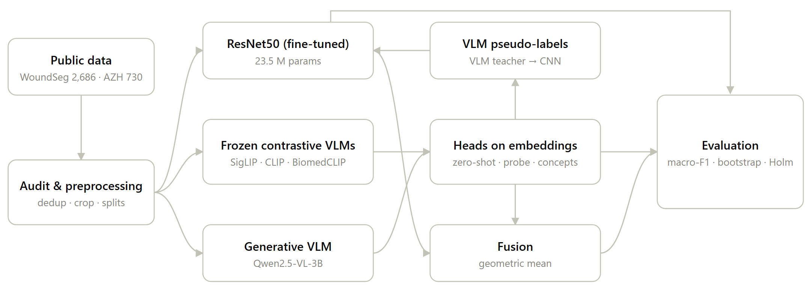
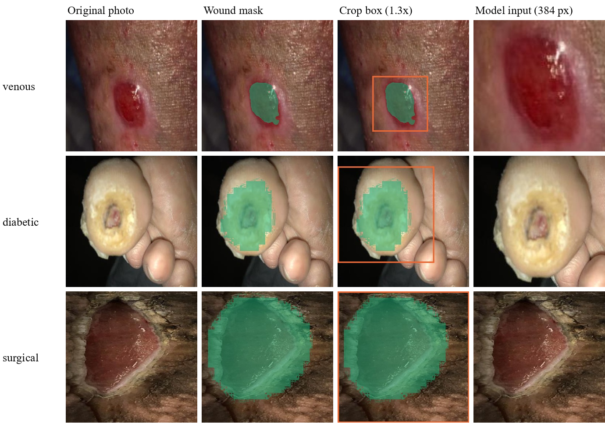
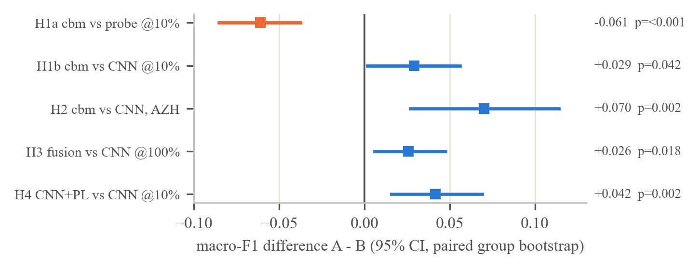
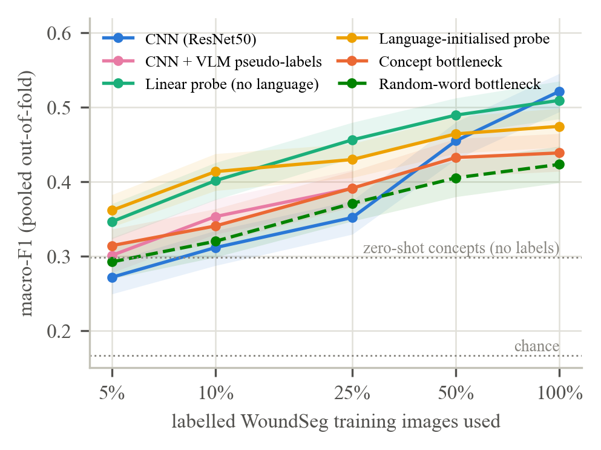
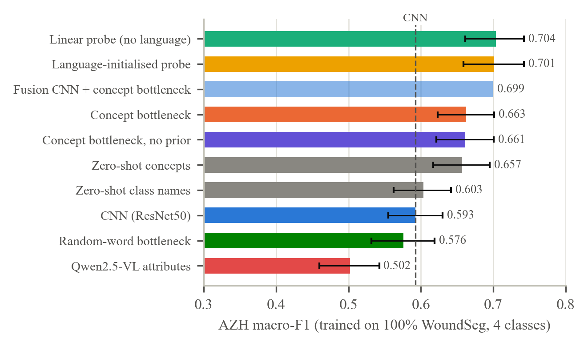
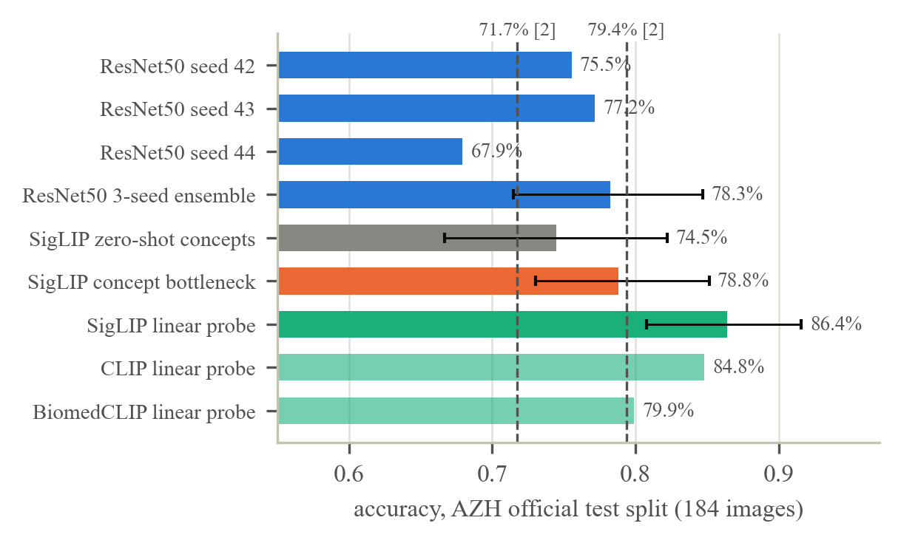

# Do Vision-Language Models Improve on a CNN Baseline for Wound Classification?

**A pre-registered study on lower-limb wound images.** Pratham Rathod, Sanjana Meena (MNIT Jaipur)

Paper: [`deliverables/WoundVLM_IEEE_paper_latex.pdf`](deliverables/WoundVLM_IEEE_paper_latex.pdf) · Slides: [`deliverables/WoundVLM_presentation.pptx`](deliverables/WoundVLM_presentation.pptx) · Demo video: https://youtu.be/hc28PzI8iSE

We classify the wound type (venous, pressure, trauma, diabetic, surgical, other) in photos of lower-limb and foot
wounds. We compare a fine-tuned **ResNet50** with frozen **vision-language models (VLMs)** in three situations:

- with few labels;
- on images from another hospital;
- combined with the CNN.

The VLMs are used in five ways:

- as frozen features (SigLIP, CLIP, BiomedCLIP);
- as a concept bottleneck over 48 clinical concepts written by an LLM;
- as zero-shot classifiers;
- as pseudo-labellers for the CNN;
- as a generative VLM (Qwen2.5-VL-3B), scored from answer-token logits.

The five hypotheses, the splits and the statistical tests were fixed before any model was trained.



## Data

| Dataset | Images | Role |
|---|---|---|
| [WoundSeg](https://huggingface.co/datasets/subbareddyoota/wseg_dataset) (Oota et al., WACV 2023) + type labels from [WSNET](https://github.com/subbareddy248/WSNET) | 2,686 photos → 1,662 labelled (6 classes) and 875 unlabelled after removing duplicates | Training, 5-fold cross-validation |
| [AZH](https://github.com/uwm-bigdata/wound-classification-using-images-and-locations) (Anisuzzaman et al., Sci. Rep. 2022) | 730 wound crops from another clinic, 4 shared classes | External test and comparison with a published result |

- **Duplicate grouping.** Near-duplicate photos are grouped by a 256-bit difference hash, and each group stays whole
  within one fold.
- **Cropping.** Each photo is cropped around its wound mask, which keeps the surrounding skin and drops most rulers and
  handwriting.
- **Sharing.** The images are not included in this repository. Download them from the links above.



## Results

Macro-F1 is the plain average of the per-class F1 scores. The 95 % confidence intervals and p-values come from a paired
bootstrap over duplicate groups, and the p-values are Holm-corrected over the five tests.

| Hypothesis | A vs B | A | B | A − B [95 % CI] | p | Verdict |
|---|---|---|---|---|---|---|
| H1a | concept bottleneck vs linear probe (same SigLIP features), 10 % labels | 0.340 | 0.401 | −0.061 [−0.085, −0.038] | < 0.001 | B better |
| H1b | concept bottleneck vs CNN, 10 % labels | 0.340 | 0.311 | +0.029 [0.002, 0.056] | 0.042 | A better |
| H2 | concept bottleneck vs CNN, external AZH test | 0.663 | 0.593 | +0.070 [0.027, 0.114] | 0.002 | A better |
| H3 | CNN + concept bottleneck fusion vs CNN, 100 % labels | 0.547 | 0.522 | +0.026 [0.006, 0.048] | 0.018 | A better |
| H4 | CNN + VLM pseudo-labels vs CNN, 10 % labels | 0.353 | 0.311 | +0.042 [0.016, 0.069] | 0.002 | A better |



**Main findings:**

- **The VLM's image features are what help.** They beat the CNN when labels are few and when the hospital changes, and
  they improve the CNN through pseudo-labels and fusion.
- **The written medical knowledge is not what drives the gain.** A plain linear probe on the same SigLIP features does
  better than the concept bottleneck (H1a).
- **The generative VLM is near chance.** Qwen2.5-VL-3B scores 0.189 macro-F1 in zero-shot.

| Few labels (WoundSeg, 5-fold) | Another hospital (AZH) |
|---|---|
|  |  |

**Comparison with a published result.** On AZH's official train/test split (4 classes, 184 test images):

| Model | Accuracy |
|---|---|
| Published CNN, image only (Anisuzzaman et al. 2022) | 71.7 % |
| Published CNN, image + wound location | 79.4 % |
| Our ResNet50 (mean of 3 seeds) | 73.6 % |
| Frozen SigLIP + linear probe | 86.4 % |



All result tables are in [`results/`](results/): [`07_summary.md`](results/07_summary.md) is the overview, and
`results/08_posthoc/` holds the per-class scores and the audits.

## Repository layout

| Path | Contents |
|---|---|
| `src/woundvlm/` | All the logic: data, VLM embeddings, heads, CNN, generative VLM, statistics, report |
| `notebooks/` | Thin notebooks `01`–`07` that call `src/`. `00_all` runs stages 02–07 in one GPU session |
| `tests/` | CPU tests, including tiny randomly initialised CLIP, SigLIP and Qwen2.5-VL models |
| `tools/kaggle_pipeline.py` | Optional: upload the data and run the notebooks on Kaggle from the command line |
| `tools/make_notebooks.py` | Regenerates `notebooks/` |
| `tools/posthoc.py` | Post-hoc tables in `results/08_posthoc/` (per-class F1, text audit, AZH comparisons) |
| `data/processed/index.csv` | Our split table: label, duplicate group, inclusion status, fold and crop box for every image (no images) |
| `results/` | Our final tables and figures |
| `deliverables/` | The paper (PDF) and the presentation (PPTX, with the demo video embedded) |

## How to reproduce

1. **Install** (Python 3.10 or newer):
   `pip install -r requirements.txt`
2. **Download the data** into `data/raw/`:
   ```
   data/raw/wseg/wseg_dataset/sample/<id>.jpg, mask/<id>.jpg   WoundSeg images and masks (Hugging Face)
   data/raw/wsnet_meta/woundids_types.csv                      wound type per image (WSNET repo)
   data/raw/azh/{Train,Test}/{BG,N,D,P,S,V}/*.jpg              AZH images (uwm-bigdata repo)
   data/raw/azh/{Train,Test}/wound_locations_Labels_AZH_{Train,Test}.csv
   ```
3. **Prepare the data (CPU):** run `notebooks/01_data.ipynb`. It writes `data/processed/`, which holds the index,
   duplicate groups, folds and crops. It rewrites `data/processed/index.csv`; `git diff data/processed/index.csv` then
   shows whether your splits match ours.
4. **Run the experiments.** You need a GPU; everything took about 7.3 GPU hours on a single 16 GB GPU.
   - **Locally:** run notebooks `02` → `07` in order, or `00_all.ipynb` for stages 02–07.
   - **On Kaggle:** put your Kaggle API token in `~/.kaggle/access_token`, then:
     ```
     python tools/kaggle_pipeline.py dataset     # uploads src/, notebooks/, data/processed/ as a private dataset
     python tools/kaggle_pipeline.py run 00      # runs everything, then copies outputs/ and results/ back
     ```
5. **Check the results.** Notebook 07 writes the tables and figures to `results/`. It never overwrites, so if
   `results/07_summary.md` already exists, a new run goes to `results/07_run<N>/`. Then run `python tools/posthoc.py`
   for the post-hoc tables.

**Tests (CPU, a few minutes):**

```
pytest -q tests
```

The VLM tests download the model processor files on first use.

Runs are resumable: finished runs are detected and skipped, and existing outputs are never overwritten.

## Notes

- This is research code on retrospective public data. It is not a medical device and makes no clinical claims.
- The concept bank (`src/woundvlm/concepts.py`) was written by a large language model before any training and was not
  reviewed by a clinician.
